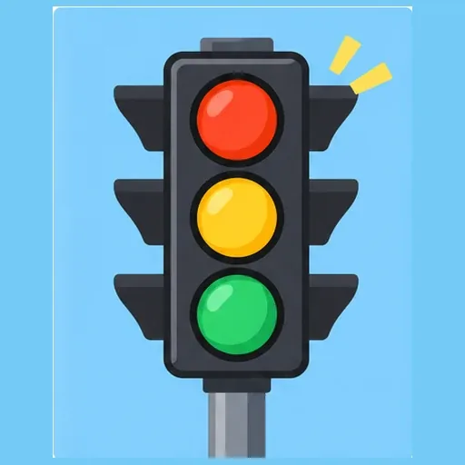
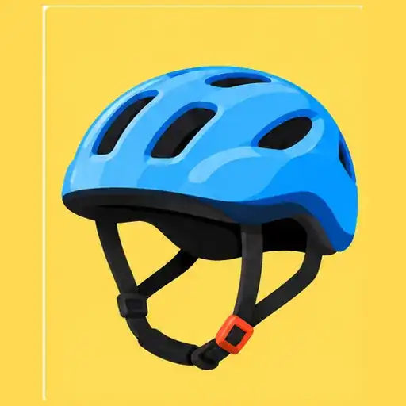
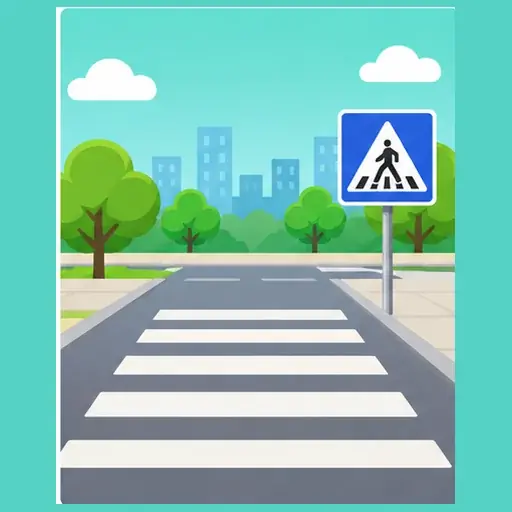
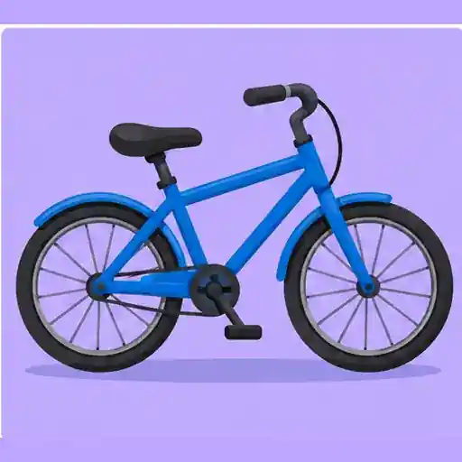
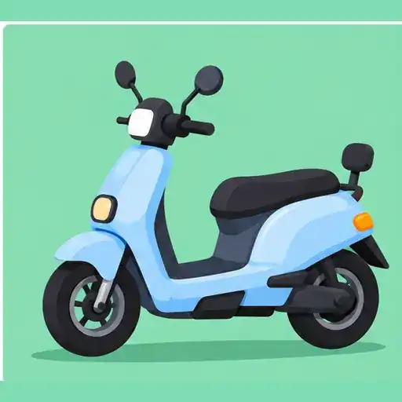

# ChatGPT WebP 自动化上传测试

本页展示 ChatGPT 本次生成并提交的 5 张独立 WebP 图片。图片均为 512 × 512 像素，单文件大小控制在 8,000–12,000 字节。

| # | 图片主题 | 文件 | 文件大小 |
|---|---|---|---:|
| 1 | 交通信号灯 | [chatgpt_auto_20261102_01_traffic_light.webp](./chatgpt_auto_20261102_01_traffic_light.webp) | 8,236 bytes |
| 2 | 儿童安全头盔 | [chatgpt_auto_20261102_02_safety_helmet.webp](./chatgpt_auto_20261102_02_safety_helmet.webp) | 8,464 bytes |
| 3 | 斑马线场景 | [chatgpt_auto_20261102_03_zebra_crossing.webp](./chatgpt_auto_20261102_03_zebra_crossing.webp) | 8,310 bytes |
| 4 | 安全自行车 | [chatgpt_auto_20261102_04_bicycle.webp](./chatgpt_auto_20261102_04_bicycle.webp) | 8,394 bytes |
| 5 | 安全电动车 | [chatgpt_auto_20261102_05_electric_scooter.webp](./chatgpt_auto_20261102_05_electric_scooter.webp) | 8,422 bytes |

## 图片预览

### 1. 交通信号灯

### 2. 儿童安全头盔

### 3. 斑马线场景

### 4. 安全自行车

### 5. 安全电动车

## 验收信息

- 格式：WebP（非改扩展名）
- 尺寸：512 × 512
- 目标体积：8,000–12,000 bytes
- 分支：main
- 本次提交：见 GitHub 提交记录
